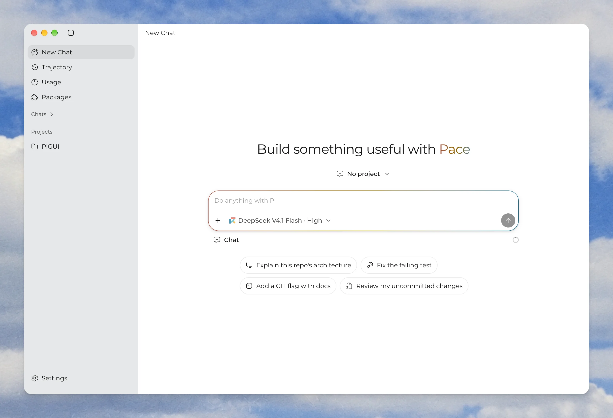

  

<h1 align="center">Pace</h1>

<a href="https://pi.dev">Pi coding agent</a> 的桌面 GUI。把 Pi 的设计与灵活性带到桌面端。

<a href="README.md">English</a> | 简体中文

  
  
  
  

Pi 是运行在终端里的 coding agent，拥有类似 VS Code 的扩展体系：扩展包可以提供工具、命令、技能、提示词和主题。Pace 把这份灵活性带到桌面端，让你自由定制一个真正属于自己的桌面 agent。Pace 的名字取自 *move at your own pace*（按自己的节奏前进）：开发者应当完全拥有自己的 agent，按自己的节奏开发与协作。

> [!NOTE]
> Pace 处于 `0.y.z` 早期开发阶段，仅支持 GitHub Releases 上的最新版本。journal 与 projection 的存储格式可能随次版本更新而变化，应用内更新器负责完成升级；Pi 的 session 数据不受影响（见[本地数据与恢复](#本地数据与恢复)）。

  

## 亮点

- **Session 时间线**：按顺序查看 agent 的思维链和工具调用，以及每一轮的 token 用量与费用。可以实时跟进一次运行，也可以回放已记录的 session，看清每一步做了什么、花了多少。
- **Session Dock**：Changes、Files、Terminal 和内嵌 Browser 共享对话旁的同一个侧边栏。
- **你的 Pi 环境原样可用**：Pace 共享 `~/.pi/agent` 下的 session、认证与扩展；Packages 页面让你无需离开应用即可管理 Pi 扩展包。
- **Pi 仍是唯一引擎**：Pace 不是 Pi 的分支，也不是另一套运行时。session 数据以 Pi 的本地日志为准；卸载 Pace 不会删除任何 Pi session。

## 什么时候不需要 Pace

- 你只在终端里用 Pi，不需要图形界面来查看费用、思维链或工具调用。
- 你使用 Windows 或 Intel Mac。安装包仅提供 Apple Silicon Mac 与 64 位 Linux 版本。
- 你想要一个不依赖 Pi 的 agent 客户端。Pace 自己没有 agent 执行循环，推理与上下文管理均由 Pi 负责。

## 快速开始

### 安装

每个 [GitHub Release](https://github.com/BubblePtr/pace/releases) 都附带为 Apple Silicon Mac 签名并公证的 DMG，以及 Linux x64 的 AppImage 和 deb。

| 平台 | 安装 | 更新 |
| --- | --- | --- |
| macOS 12+（Apple Silicon） | 打开 DMG，把 Pace 拖入“应用程序”。 | 应用内更新 |
| Linux AppImage（x64） | `chmod +x` 后直接运行。缺少 FUSE 时加上 `--appimage-extract-and-run`。 | 应用内更新 |
| Linux deb（x64） | 用 `apt` 安装。 | 手动安装新包 |

Pi 运行时已随应用内置，无需单独安装 `pi`。更多 Linux 说明见 [`docs/release/linux.md`](docs/release/linux.md)。如需从源码运行，参见 [CONTRIBUTING.md 的 Setup](CONTRIBUTING.md#setup)。

### 开始第一个 session

1. 首次启动时，Pace 会检查内置 Pi 运行时、数据目录和模型 provider 的登录状态，并显示数据的保存位置。如果尚未登录 provider，可在终端中运行 `pi` 完成登录；Pace 无需重启即可识别新的登录状态。
2. 选择一个项目目录，新建 session。
3. 发送第一条消息，比如：*解释一下这个仓库的架构*。
4. 在 Live Chat 中阅读对话，在 Trajectory 中查看思维链和工具调用，在状态栏中查看本轮的 token 用量与费用。

## 设计原则

- **上下文归 Pi 所有。** `~/.pi` 下的 Pi session 日志是唯一事实来源。Pace 从不组装提示词，也从不写入该日志；它持久化的只是 Pi 事件流的投影，存放在自己的目录里。
- **界面由事件日志驱动。** 每个 Pi 事件都会被标准化、编号并追加进 journal。实时时间线、历史回放与费用统计全部由此推导。
- **GUI 永不阻塞 agent。** 后端运行在独立的 Electron `utilityProcess` 中，每个根 session 都在自己的进程里运行 Pi，繁重的日志解析或 session 崩溃都无法冻结窗口。
- **为扩展而生。** 事件路由、Session Dock 和 gateway 能力模型的设计目标，就是让 Pi 扩展能贡献自己的面板与控件；对应的协议是下面路线图的第一项。

这些原则如何落地为代码，见 [`docs/architecture.md`](docs/architecture.md)。

## 扩展机制

Pace 原样复用 Pi 的 `Package → Extension / Skill / Prompt / Theme` 模型。侧边栏的 **Packages** 页可以安装、卸载和更新扩展包，启用或停用其中的单个资源，也可以把本地资源加入 Pi 的约定目录。扩展包行会标记可用更新，资源详情会展示最近活跃 session 中的扩展错误。所有变更在下一个新建 session 时生效。

扩展暂时还无法贡献 GUI 面板。按优先级排列的路线图：

1. **Extension Surface 协议**：让 Pi 扩展注册自己的面板，由与内置视图相同的事件流驱动。
2. **多 agent 工作流可视化**：把多步骤、多 agent 的运行渲染成执行拓扑图，而不是交织在一起的日志。
3. **可插拔的运行时调优**：把提示词注入、权限管控和中断策略开放为扩展点，行为改动以扩展包的形式发布，无需修改客户端代码。

## 本地数据与恢复

| 数据 | 安装版 | `bun run dev` | 归属 |
| --- | --- | --- | --- |
| Pi session、认证、扩展 | `~/.pi/agent` | 共享 | session 真相归 Pi 所有；Pace 通过 SDK 管理用户资源配置并导入本地资源。 |
| session journal、projection、预检状态 | `~/.pace` | `~/.pace-dev` | Pace。可用 `PACE_DATA_DIR` 覆盖（`PIGUI_DATA_DIR` 为已弃用别名）。 |
| 渲染层偏好（项目注册表、草稿、模型选择）、Chromium 用户配置 | Electron userData | userData `-dev` | Pace。 |

删除 Pace 的数据目录只会丢失界面历史与费用统计，绝不会触及 Pi session 数据；Pi 随时可以从自己的日志完整重建状态。

## 支持与安全

- **Bug 与功能请求**：提交到 [GitHub Issues](https://github.com/BubblePtr/pace/issues)。
- **安全漏洞**：请勿提交公开 Issue。请按照 [SECURITY.md](SECURITY.md) 的说明通过 GitHub 私密报告。仅支持最新版本。
- **版本说明**：每个版本的更新说明见 [GitHub Releases](https://github.com/BubblePtr/pace/releases)。

## 参与贡献

从 [CONTRIBUTING.md](CONTRIBUTING.md) 开始：环境搭建、验证命令、分支规范和第一个练手 PR。[`docs/architecture.md`](docs/architecture.md) 描绘了事件流水线以及各职责对应的代码位置；[`AGENTS.md`](AGENTS.md) 是完整规则集，人类贡献者与 coding agent 同样适用。参与本项目即表示你同意遵守[行为准则](CODE_OF_CONDUCT.md)。

## 许可证

Pace 以 [Apache License 2.0](LICENSE) 发布。Pace 的名称与图标不在该授权范围内。Pi 是独立项目，有自己的许可证。
