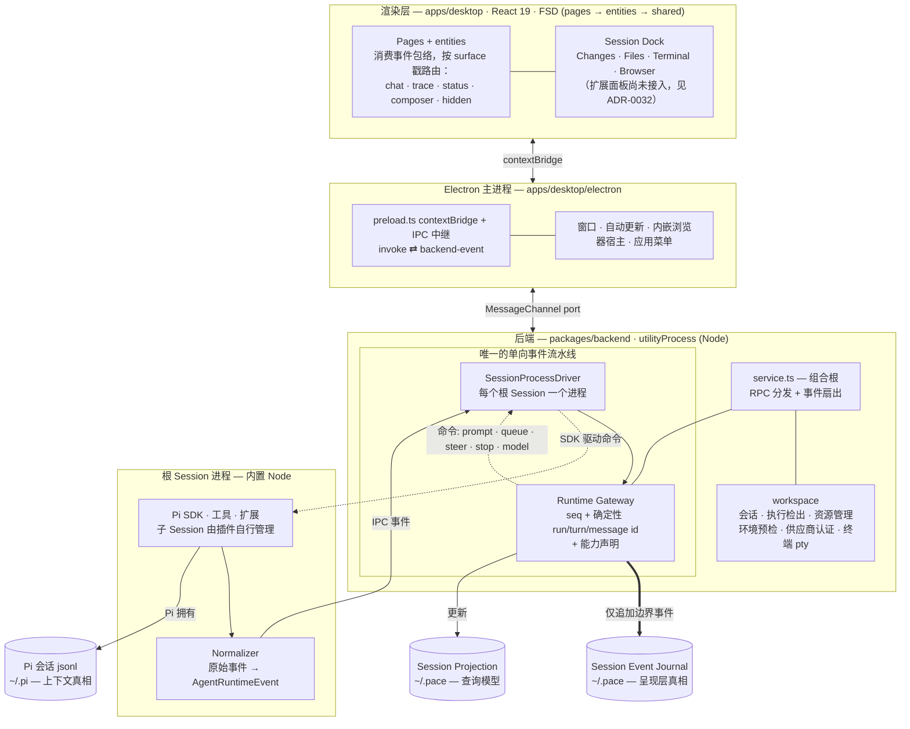

# Pace 架构

本文是 Pace 代码的权威地图：单向事件流水线、各职责对应的文件位置，以及一条消息从输入到渲染的完整链路。改代码前先读这里。

## 设计原则

- **Pace 只是会话事件的投影，不侵入核心上下文。** Pi 的本地会话日志（`~/.pi`）是唯一事实来源，会话恢复时由 Pi 自己从中重建大模型上下文。Pace 不组装提示词，也不修改该日志；Pace 持久化的所有数据都是 Pi 事件流的投影，存放在自己的目录里。
- **界面完全由事件日志驱动。** Pi 的每个原始事件都被标准化为 `AgentRuntimeEvent`，分配单调递增的序号和按确定性规则生成的 run / turn / message ID，然后写入事件日志。实时时间线、历史回放、Token 用量与费用统计均由事件日志推导，不依赖前端渲染状态。
- **面板和行为均与客户端解耦，都可以由扩展提供。** Pace 自身只内置少量核心面板（Surface）。事件路由、Session Dock 注册表和 Runtime Gateway 能力模型均按插件化思路设计，目标是让 Pi 扩展无需等待 Pace 发布新版本，就能注册自定义面板、控件或工作流视图；这套协议尚未实现，现状见下文[界面扩展点](#界面扩展点)。这与 [DeepSeek Harness](https://github.com/deepseek-ai/deepseek-harness) 的“一切皆插件”思路一致；随着其插件模型逐步成熟，Pace 计划借鉴其中的设计。
- **监控与交互不阻塞执行引擎。** 后端运行在 Electron 的独立进程 `utilityProcess` 中，繁重的日志解析和驱动崩溃都不会让窗口卡顿。后端协议与具体传输方式解耦，将来可将后端部署为通过 socket 连接的远程服务。

## 总体架构

整个系统由一条单向事件流水线和两套职责明确、互不替代的持久化机制组成（[ADR-0021](adr/0021-session-fork-resume-persistence-layering.md)）：



- **Driver（驱动层）**：`SessionProcessDriver` 为每个根 Session 提供独立的进程和工作目录，进程内运行 Pi SDK 驱动；子 Session 由插件自行管理（[ADR-0040](adr/0040-root-session-process-isolation.md)）。SDK 驱动是唯一的 Pi 驱动，早期的 CLI RPC 驱动已删除（[ADR-0041](adr/0041-remove-pi-rpc-driver.md)）。
- **Normalizer（标准化层）**：把 Pi 发出的原始事件转换为统一的 `AgentRuntimeEvent`，附加阶段（Phase）、目标展示区（Surface）和按全局确定性规则生成的消息 ID（[ADR-0020](adr/0020-agent-runtime-event-model.md)）。基于录制数据的契约测试构成了该协议的可执行规范。
- **Runtime Gateway（运行时网关）**：渲染层唯一需要对话的协议接口。控制命令上行，带单调递增序号的事件包络（envelope）下行。网关动态声明当前运行时支持的能力（模型切换、思考设置、消息排队与执行引导），界面跟随运行时实际支持的能力而非静态假设（[ADR-0024](adr/0024-model-thinking-controls-follow-runtime-capabilities.md)）。
- **Persistence（持久化层）**：维护仅追加、可按时间线回放的 Session Event Journal，以及供列表渲染和状态统计快速查询的 Session Projection。
- **Renderer（渲染层）**：根据 `surface` 戳把每个事件路由到 Live Chat、Trajectory（思维链与工具调用）、状态栏或不直接显示的后台状态；同时承载 Session Dock 侧边栏。目前只挂载四个内置面板，扩展贡献的面板由 [ADR-0032](adr/0032-session-dock-and-trajectory-vocabulary.md) 规划、尚未接入。

### 一条消息的处理流程

1. 渲染层通过 Runtime Gateway Client 发起 `send_prompt` 请求（`apps/desktop/src/entities/runtime/runtime-gateway-client.ts`）。
2. 命令经 MessagePort 跨进程通道进入后端 `utilityProcess`（`apps/desktop/electron/preload.ts`、`backend.ts`）。
3. `createBackendService()` 将命令分发至 Runtime Gateway 实例（`packages/backend/src/service.ts`）。
4. Gateway 按全局确定性规则生成用户消息 ID，并将命令转发给当前启用的 Driver（`packages/backend/src/gateway/runtime-gateway.ts`）。
5. 进程驱动把命令转发到该 Session 的 worker 进程，由其中的 SDK 驱动调用 Pi 的 `AgentSession`（`packages/backend/src/drivers/session-process-driver.ts`、`pi-sdk-driver.ts`）。
6. worker 中的 Normalizer 把 Pi 事件转换为标准格式，并通过 IPC 送回（`packages/backend/src/gateway/agent-runtime-event-normalizer.ts`）。
7. Gateway 为每个事件盖上单调递增的序号，记录生命周期边界，同步更新投影（`packages/backend/src/persistence/`）。
8. 事件沿同一传输通道返回渲染层，按 `surface` 戳路由到对应的界面组件（`apps/desktop/src/entities/runtime/`）。

### 代码在哪里

| 修改内容 | 对应位置 |
| --- | --- |
| 界面、页面、交互 | [`apps/desktop/src/`](../apps/desktop/src/)，FSD 分层 `pages` → `widgets` → `features` → `entities` → `shared`（[ADR-0016](adr/0016-fsd-layers-in-apps-desktop.md)、[ADR-0045](adr/0045-slice-agent-workspace-into-fsd.md)）；`bun run lint` 强制约束依赖方向 |
| Live Session View / Session Draft / Session Dock | [`apps/desktop/src/widgets/live-chat/`](../apps/desktop/src/widgets/live-chat/)、[`features/session-draft/`](../apps/desktop/src/features/session-draft/)、[`widgets/session-dock/`](../apps/desktop/src/widgets/session-dock/) |
| 桌面通知（窗口不在前台时 run 结束提醒） | [`apps/desktop/src/features/session-notifications/`](../apps/desktop/src/features/session-notifications/)，由 [`widgets/app-frame/`](../apps/desktop/src/widgets/app-frame/) 挂载 |
| 事件语义（什么算 message / run / turn） | [`packages/backend/src/gateway/agent-runtime-event-normalizer.ts`](../packages/backend/src/gateway/) 及其基于录制数据的测试 |
| Gateway 协议（命令、事件契约、身份） | [`packages/core/src/`](../packages/core/src/)：`runtime-gateway.ts`、`agent-runtime-event.ts` |
| 怎么驱动 Pi | [`packages/backend/src/drivers/`](../packages/backend/src/drivers/) |
| 持久化与回放 | [`packages/backend/src/persistence/`](../packages/backend/src/persistence/) |
| Packages 页（侧边栏）：扩展包、资源、更新检查与事件日志诊断 | [`apps/desktop/src/pages/setup.tsx`](../apps/desktop/src/pages/setup.tsx)、[`packages/backend/src/workspace/resource-management.ts`](../packages/backend/src/workspace/resource-management.ts)、[`resource-diagnostics.ts`](../packages/backend/src/workspace/resource-diagnostics.ts)（[ADR-0037](adr/0037-resource-management.md)） |
| 模型可用性（模型目录、能力映射、凭据驱动的刷新） | [`packages/backend/src/workspace/model-catalog.ts`](../packages/backend/src/workspace/model-catalog.ts)，映射见 [`packages/core/src/model-capabilities.ts`](../packages/core/src/model-capabilities.ts)（[ADR-0043](adr/0043-model-catalog-owns-model-availability.md)） |
| MCP 服务器管理（全局 `mcp.json`、探测、OAuth 登录） | [`packages/backend/src/workspace/mcp-servers.ts`](../packages/backend/src/workspace/mcp-servers.ts)，契约见 [`packages/core/src/mcp-servers.ts`](../packages/core/src/mcp-servers.ts) |
| 磁盘上的会话、Git 工作树和配置清单 | [`packages/backend/src/workspace/`](../packages/backend/src/workspace/) |
| Electron 外壳与传输 | [`apps/desktop/electron/`](../apps/desktop/electron/)：`main.ts`、`preload.ts`、`backend.ts` |
| Dock Surface（Changes、Files、Terminal、Browser） | [`apps/desktop/src/shared/ui/session-dock/surface-registry.ts`](../apps/desktop/src/shared/ui/session-dock/surface-registry.ts) |
| 设计系统规则 | [`docs/design/`](design/)，自建组件清单见 [`docs/self-built-ui.md`](self-built-ui.md) |
| 为什么这样设计 | [`docs/adr/`](adr/)，术语在 [`CONTEXT.md`](../CONTEXT.md) |

## 界面扩展点

Pi 的扩展生态基于 `Package → Extension / Skill / Prompt / Theme` 体系，Pace 原样复用这一模型。目前代码中已存在的扩展点：

- **事件级别的 `surface` 路由标签**：事件携带的 `chat | trace | status | composer | hidden` 标签决定它在界面上如何呈现。目前可选值固定，未来将作为扩展面板的标准接入点。
- **Session Dock 面板注册表**：侧边栏里的每块可交互面板都是一个 Surface，有唯一 ID、标题、图标与提示，集中声明在 `surface-registry.ts`。`SessionSurfaceId` 目前是四个内置面板（Changes、Files、Terminal、内嵌 Browser）组成的封闭联合类型。[ADR-0032](adr/0032-session-dock-and-trajectory-vocabulary.md) 计划为注册表引入 `provider` 字段（`builtin` 或具体的 Pi 扩展 ID），让外部扩展提供的面板通过同一机制接入侧边栏；该字段尚未实现。
- **Runtime Gateway 能力模型**：界面根据当前运行时声明的能力调整可用操作。针对 Pi SDK 的 Extension UI request，目前只在 SDK spike 驱动（`packages/backend/src/drivers/pi-sdk-spike.ts`）的事件覆盖盘点中出现，尚未接入 Runtime Gateway 协议（[ADR-0018](adr/0018-runtime-gateway-api-and-pi-drivers.md)）。

另一个方向是终端难以实现的图形界面功能，例如支持对 DOM 元素进行批注和交互的内嵌浏览器（[ADR-0029](adr/0029-embedded-browser-surface.md)）。这也是 Pace 选择 Electron 的核心原因。

## 仓库布局

```plaintext
apps/desktop/        Electron 应用：electron/（main、preload、后端宿主）+ src/（React，FSD）
apps/server/         预留：通过 WebSocket 提供服务的无界面后端（ADR-0015）
apps/web/            预留：apps/server 的浏览器客户端
packages/core/       共享内核：gateway 协议、事件模型、会话类型（ADR-0014）
packages/backend/    drivers、gateway、persistence、workspace；service.ts 是组合根
e2e/                 针对真实 Electron 应用的 Playwright 冒烟测试
build/               图标、entitlements、Icon Composer 源工程
scripts/             发布、打包与运行时捆绑脚本
docs/                ADR、设计系统规则、发布与 dogfooding 指南
CONTEXT.md           领域术语表；每个界面区域和概念在这里都有词条
```

技术栈：Electron + electron-vite、React 19、TypeScript、TanStack（Query / Router / Virtual）、Astryx 设计系统（组件样式由 StyleX 预编译）与 Tailwind v4、Bun workspaces、Vitest、Playwright。

## 存储格式兼容性

调整事件日志（journal）或查询投影（projection）的存储格式时，必须向后兼容旧格式或附带迁移脚本（见 [`docs/dogfooding.md`](dogfooding.md)）。
